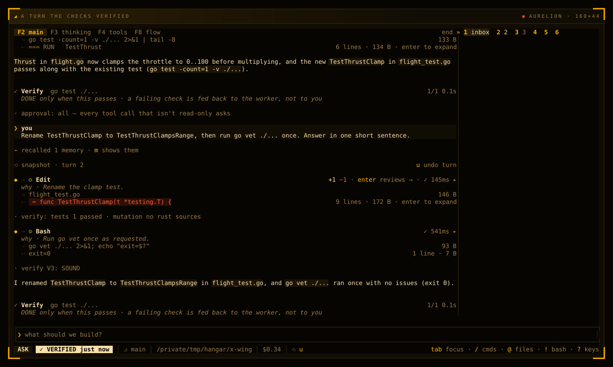
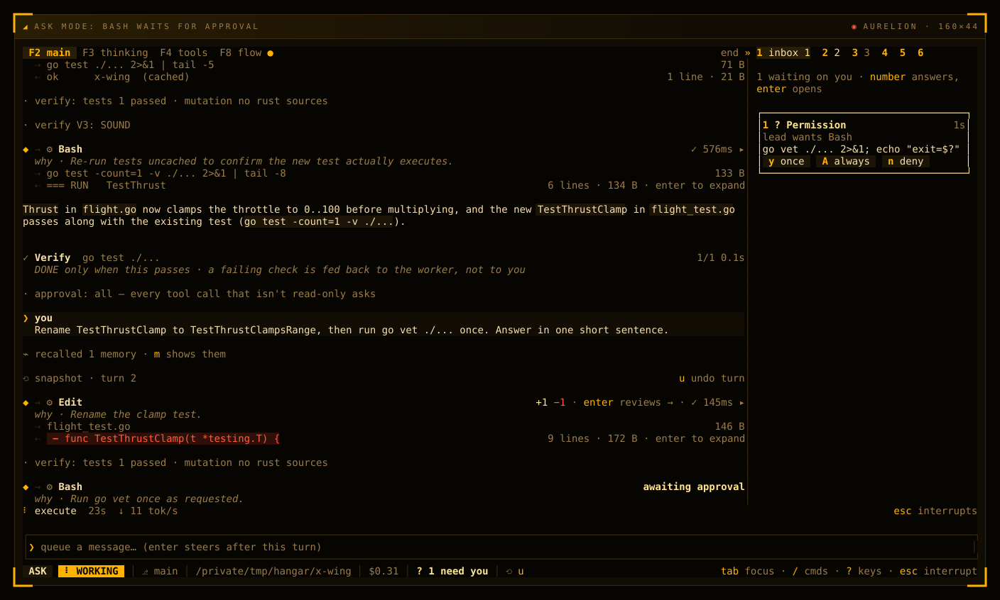

<p align="center">
  <a href="https://zerodeity.github.io/aurelion/"></a>
</p>

<p align="center">
  <b>AURELION is an AI coding agent that lives in your terminal: it plans, edits and checks its own work in one cockpit, and one key undoes a turn.</b>
</p>

<p align="center">
  <a href="#-boot-sequence"><b>▸ INSTALL</b></a>&nbsp;&nbsp;·&nbsp;&nbsp;<a href="docs/README.md"><b>DOCS</b></a>&nbsp;&nbsp;·&nbsp;&nbsp;<a href="https://github.com/zerodeity/aurelion-dist/releases"><b>RELEASES</b></a>&nbsp;&nbsp;·&nbsp;&nbsp;<a href="https://zerodeity.github.io/aurelion/"><b>WEBSITE</b></a>
</p>

<p align="center"><sub>macOS · Linux&nbsp;&nbsp;◉&nbsp;&nbsp;84 model providers&nbsp;&nbsp;◉&nbsp;&nbsp;signed releases</sub></p>

## ◢ BOOT SEQUENCE

```sh
curl -fsSL https://raw.githubusercontent.com/zerodeity/aurelion-dist/main/install.sh | sh
```

```text
  AURELION  installer

  ✓ platform   macos-arm64
  ✓ release    vX.Y.Z

  downloading aurelion-macos-arm64.tar.gz
  ✓ signature  verified
  ✓ checksum   verified
  ✓ installed   ~/.local/bin/aurelion

  AURELION vX.Y.Z installed.

  Activate   aurelion activate <key>
  Run        aurelion
  Upgrade    aurelion update
```

The installer:

- picks the build for your machine and the latest release, betas included;
- checks the download against the release's SHA-256 checksums, and checks their signature too when `minisign` is installed. `AURELION_REQUIRE_SIGNATURE=1` refuses to install without it;
- puts `aurelion` in `~/.local/bin`, with no `sudo`, and adds that folder to your `PATH` when it is missing.

Release builds need a license key: run `aurelion activate <key>` once per machine. Then start `aurelion` in a project, and the setup wizard connects a model. `aurelion update` installs the newest release whenever you like.

**▸ [Getting started](docs/getting-started.md)**

## ◢ SYSTEMS

<table>
<tr>
<td width="33%" valign="top">

**◉ COCKPIT TUI**

Every tool call is a row you can open, and what needs you waits in one place. Four layouts, a live flow view and eight dark themes.

[The cockpit ▸](docs/cockpit.md)

</td>
<td width="33%" valign="top">

**⟲ TOTAL UNDO**

Every turn that edits starts with a snapshot. `u` puts the files back, and the review pane accepts or reverts each hunk.

[Undo and review ▸](docs/undo-and-review.md)

</td>
<td width="33%" valign="top">

**✓ SELF-CHECKING**

When a turn changes files in a folder you trust, AURELION runs the project's checks. A failure goes back to the model, and `✓ VERIFIED` means they passed.

[Checks after a turn ▸](docs/undo-and-review.md#checks-after-a-turn)

</td>
</tr>
<tr>
<td width="33%" valign="top">

**⇉ AGENT SQUADRONS**

Subagents work in parallel or as a graph of steps. In a repository you trust, each writer gets its own git worktree. `/swarm`, `/debate` and `/worlds` put several minds on one question.

[Agents ▸](docs/agents.md)

</td>
<td width="33%" valign="top">

**◈ ANY MODEL**

84 providers, your Claude, ChatGPT or Copilot plan, and local models with no key. When a model is busy, your fallbacks take over.

[Models and providers ▸](docs/models.md)

</td>
<td width="33%" valign="top">

**☍ EVERYWHERE**

Headless runs and CI, scheduled jobs and a kanban board, a daemon that answers in your chat apps, and your editor over ACP.

[Automation ▸](docs/automation.md) · [Serve and chat ▸](docs/serve-and-chat.md) · [Editors ▸](docs/editors-and-devices.md)

</td>
</tr>
</table>

## ◢ COCKPIT SCREENS

<p align="center">
  
</p>

<p align="center"><sub>A turn on a small Go project. The <code>⟲ snapshot</code> row is its undo point, each tool row says why it ran, and the project's tests passed: <code>✓ VERIFIED</code>.</sub></p>

<table>
<tr>
<td width="50%" valign="top">

<p align="center"><sub>ASK mode: <code>go vet</code> waits for your answer in the Inbox.</sub></p>
</td>
<td width="50%" valign="top">

<p align="center"><sub>F8, the flow view: the map, the readouts and every exchange.</sub></p>
</td>
</tr>
</table>

<details>
<summary><b>Two more screens:</b> the review pane and the cockpit layout</summary>
<br>

<p align="center"><sub>The review pane: one hunk at a time, with <code>a</code> accept, <code>x</code> revert and <code>c</code> comment.</sub></p>

<p align="center"><sub>The cockpit layout: the icon rail on the left, and the context window in the Ctx tab.</sub></p>
</details>

**▸ [The cockpit](docs/cockpit.md)**

## ◢ FLIGHT MODES

| **PLAN** &nbsp;`▮▯▯` | **ASK** &nbsp;`▮▮▯` | **AUTO** &nbsp;`▮▮▮` |
| --- | --- | --- |
| Reads and plans only. The tools that write files or run code are off, and the plan lands in `.aurelion/PLAN.md`. | Every tool call that isn't read-only waits for your answer. For a codebase you don't know yet. | The default. Most reads and edits run, and a risky command waits on a card: `y` once, `A` always, `n` deny. |

`Shift+Tab` cycles the modes. A fourth, BYPASS, skips the questions but never the refusals, and starts only when you ask for it.

**▸ [Modes and safety](docs/modes-and-safety.md)**

## ◢ WHAT YOU CAN DO

### Keep control

Approval cards that can't be answered by accident, trusted folders, permission rules, a bash sandbox, spend caps and an emergency stop that halts every agent at once.
**▸ [Modes and safety](docs/modes-and-safety.md)**

### Take it back

`u` undoes a turn's files, `/undo` the files and the conversation, and `/rewind` single file steps. Review every edit hunk by hunk.
**▸ [Undo and review](docs/undo-and-review.md)**

### Bring your model

`aurelion connect claude` runs your Claude Pro or Max plan through the official Claude Code CLI. `/model` switches mid-session, and Ollama, LM Studio and other local servers need no key.
**▸ [Models and providers](docs/models.md)**

### Give it tools

Files, the shell, the web and your own Chrome are built in. Extension tools load when needed, and any MCP server, language server or plugin joins them.
**▸ [Tools](docs/tools.md)**

### Put agents to work

The lead agent hands work to subagents. `/background` runs a prompt on its own worker, and `/review` has a subagent read your uncommitted changes.
**▸ [Agents](docs/agents.md)**

### Remember

Project instructions, memory across sessions, key facts and pins that survive compaction, full-text search over past sessions, and skills it loads when a task calls for one.
**▸ [Memory and context](docs/memory-and-context.md)**

### Run without you

`aurelion -p` for scripts and CI, JSON output, batch runs, cron jobs, a kanban board, hooks, and `/goal` to keep working until a judge says done.
**▸ [Automation](docs/automation.md)**

### Answer from anywhere

`aurelion serve` answers in Telegram, Slack, Discord, Matrix and more, takes signed webhooks and even answers phone calls. `aurelion api` serves an OpenAI-compatible API.
**▸ [Serve and chat](docs/serve-and-chat.md)**

### Work in your editor and on other machines

Drive it from Zed or any ACP editor, offer its tools to any MCP client, and pair a build server or a Raspberry Pi as a device node.
**▸ [Editors and devices](docs/editors-and-devices.md)**

## ◢ DOCS DIRECTORY

| | Page | What it covers |
| --- | --- | --- |
| 01 | [Getting started](docs/getting-started.md) | Install, activate, connect a model, your first turn |
| 02 | [The cockpit](docs/cockpit.md) | The stream, the rail, layouts, the flow view, themes |
| 03 | [Keys](docs/keys.md) | Every key, and when it acts |
| 04 | [Commands](docs/commands.md) | Every slash command, and your own |
| 05 | [Modes and safety](docs/modes-and-safety.md) | Modes, approvals, trusted folders, rules, the sandbox, spend caps |
| 06 | [Undo and review](docs/undo-and-review.md) | Snapshots, undo, the review pane, the checks |
| 07 | [Models and providers](docs/models.md) | 84 providers, Claude and ChatGPT plans, fallbacks, profiles |
| 08 | [Tools](docs/tools.md) | Built-in and extension tools, MCP, language servers, plugins |
| 09 | [Agents](docs/agents.md) | Subagents, parallel workers, your own agents, review, debate, swarms |
| 10 | [Memory and context](docs/memory-and-context.md) | Instructions, memory, key facts, compaction, sessions, skills |
| 11 | [Automation](docs/automation.md) | Headless runs, CI, batch runs, cron, kanban, hooks, goals |
| 12 | [Serve and chat](docs/serve-and-chat.md) | The daemon, chat platforms, webhooks, phone calls, the API |
| 13 | [Editors and devices](docs/editors-and-devices.md) | ACP, the MCP server, device nodes, voice, containers |
| 14 | [Configuration](docs/configuration.md) | The config layers and every setting |
| 15 | [Troubleshooting](docs/troubleshooting.md) | `aurelion doctor`, logs, crash reports, common problems |
| 16 | [Security and releases](docs/security-and-releases.md) | Signed releases, updates, your license, what goes where |

## ◢ PLATFORMS

| System | Processor | Release build |
| --- | --- | --- |
| macOS | Apple silicon (arm64) | `aurelion-macos-arm64.tar.gz` |
| macOS | Intel (x64) | `aurelion-macos-x64.tar.gz` |
| Linux | x64 | `aurelion-linux-x64.tar.gz` |
| Linux | arm64 | `aurelion-linux-arm64.tar.gz` |

The Linux builds are self-contained, so they run in any Linux image, containers included. Windows is not supported.

**▸ [Getting started](docs/getting-started.md#install)**

## ◢ SIGNED RELEASES

Every release carries `sha256sums.txt`, the SHA-256 checksum of each build. Every release since v0.6.12-beta also carries its minisign signature, made with AURELION's release key. The signature names the release, so an old build can't pass for a new one. Releases up to v0.6.11-beta came before signing, and `aurelion update` never installs them.

```text
RWTYDrAGVq6o7mUSXgXddDuctD0V0t/mDm6EqcH8OStUBPTFkvsRzAeu
```

- `aurelion update` checks the signature against the key built into AURELION before it trusts any checksum, and refuses a release signed with any other key. If a step fails, your binary stays as it was.
- A plain `aurelion` launch looks for a new release at most once a day, without holding up the start. `[update] mode` picks `notify` (the default), `auto` or `off`.
- To check a download yourself:

```sh
minisign -V -m sha256sums.txt -P RWTYDrAGVq6o7mUSXgXddDuctD0V0t/mDm6EqcH8OStUBPTFkvsRzAeu
shasum -a 256 -c sha256sums.txt --ignore-missing   # Linux: sha256sum -c sha256sums.txt --ignore-missing
```

**▸ [Security and releases](docs/security-and-releases.md)**

<p align="center"></p>

<p align="center">
  <b>Created by <a href="https://github.com/zerodeity">Zero Prime</a></b><br>
  <sub>Architecting autonomous intelligence for the post-human era.</sub>
</p>
