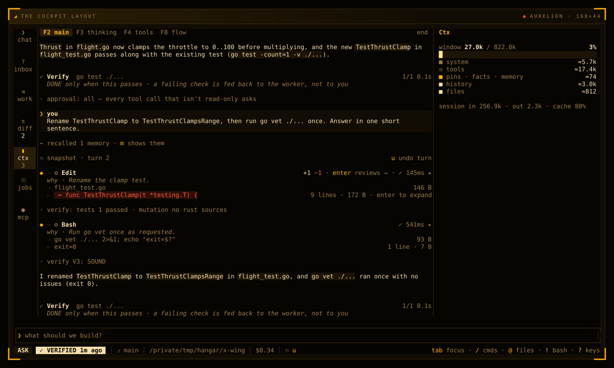
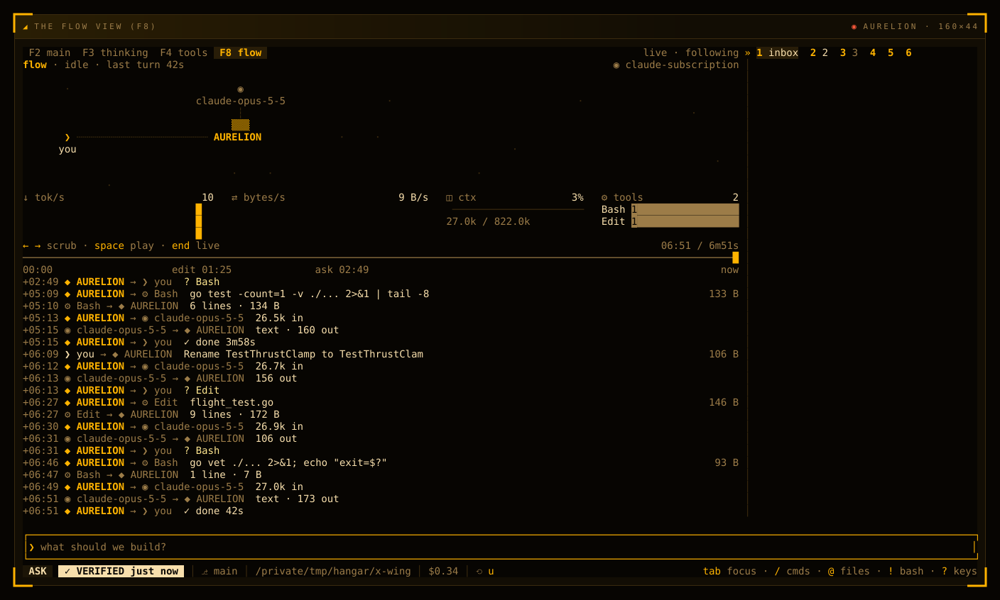

# The cockpit

The cockpit is AURELION's full-screen terminal interface. The conversation runs down the middle, every tool call is a row you can open, and what needs you waits in one place. It adapts to your terminal's width, comes in four layouts and eight dark themes, and works with the keyboard or the mouse. This page is a tour.

## The screen at a glance

On a terminal 140 columns wide or more, the default layout (`rails`) has four parts:

- **The stream**, in the middle: your prompts, the agent's answers and a row for every tool call.
- **The left column**: Workers (the subagents at work) and Todos. Each takes no width while it is empty.
- **The rail**, on the right: six tabs that hold approvals, changed files, context, jobs, models and MCP servers.
- **The prompt and the status row**, at the bottom.

Narrower terminals get the same parts, rearranged:

| Width | What you see |
| --- | --- |
| 140 columns or more | The full layout, in any of the four [layouts](#layouts). |
| 100 to 139 | A one-row HUD on top (model, context, agents, todos, MCP, spend) and a dock that is the same rail. `Tab` or a click on the HUD's counts opens Workers and Todos over the stream. |
| Under 100 | One column, with tabs `1 chat 2 inbox 3 agents 4 diff 5 more`. `5` again moves `more` on through ctx, jobs, model and MCP. |

## The stream

The stream is the conversation, top to bottom. It shows:

- **Your prompts**, under `❯ you`.
- **The agent's answers**, as formatted Markdown.
- **Tool rows.** Each call reads sender, arrow, tool: `◆ → ⚙︎ Edit`. Under it, an italic `why ·` line says why the call was made. `⇢` shows what went in and `⇠` what came back. At the right end: `+n −m` for an edit, the state (a spinner while it runs, `awaiting approval` while it waits for you, then `✓` or `✗`), the time it took and `▸`. `Enter` or a click opens the full output.
- **MCP tools** read `⬡ server.tool`, and a subagent spawned with `task` reads `⇉`.
- **The snapshot row**, `⟲ snapshot · turn 2`, where a turn that edits begins. `u` puts that turn back. See [Undo and review](undo-and-review.md).
- **The recall row**, `⌁ recalled 1 memory · m shows them`, when the turn drew on memory, facts or pins.
- **The Verify row**, `✓ Verify go test ./...`, when the checks run after a turn.
- **Notices**, the short `·` lines: a mode change, a check result, a warning.

**Toasts** are the app's own short notes, in the top right corner of the stream: a hint when a key can't act yet, such as `answer the waiting card first`, `copied 120 chars` after you select text with the mouse, `Ctrl+C again to quit`, and errors such as an unknown command. `✓` marks a note and `✗` an error. Up to three stack there, newest at the bottom, and each goes after 6 seconds.

Four views share the stream's space. `F2` is the main view, `F3` the thinking, `F4` the tool calls alone, and `F8` the [flow view](#the-flow-view). `Ctrl+O` cycles them. The tab strip on top shows `end` while you follow the tail, or how far you scrolled up.

The stream follows new output. Scroll up and it stays put; `End` jumps back to the tail and follows again.

## The rail

The rail's six tabs keep everything that isn't conversation:

| Tab | What it holds |
| --- | --- |
| `1` Inbox | Approval cards and questions that wait for you. While one waits, the rail stays here. |
| `2` Changes | The files this session touched, grouped by worktree. `Enter` opens one in the review pane, `s` stages it. |
| `3` Ctx | The context window split into its parts (system, tools, pins, facts and memory, history, files), the budget, and the session's tokens in and out. From 75 % full it offers a compaction preview. |
| `4` Jobs | Cron jobs, kanban cards, and the chats a running `aurelion serve` answers. A failed cron run shows here. |
| `5` Model | The lead model, the workers', the small, fallback and vision models, and the last fallback taken. |
| `6` MCP | Each MCP server's health, with its calls folded into its row. |

The tab strip shows each tab's number and a count when there is one: cards waiting on Inbox, files on Changes, the context percentage on Ctx, and running jobs on Jobs, in red when a job failed. Pick a tab with `Alt+1` to `Alt+6` from anywhere, with `1` to `6` once the stream or the rail has focus, with `←` `→` in the rail, or with a click. The tab you pick is kept.

## The left column

**Workers** is a two-line tree of the subagents: `Workers 3 live · 1 done · 2 wait`, then a row per worker saying what it does. The rows that don't fit are counted (`+4 more`). With the pane focused, `↑` `↓` pick a worker and `Enter` opens its session in an inspector. [Agents](agents.md) covers subagents.

**Todos** is the agent's task list for the current job. It survives restarts and compaction.

## The status row

The bottom line reads left to right:

- **The mode chip**: `PLAN`, `AUTO`, `ASK` or `BYPASS`. A click cycles it like `Shift+Tab`. See [Modes and safety](modes-and-safety.md).
- **The run chip**: `⠹ WORKING` while a turn runs. Afterwards it says how the turn ended: `✓ VERIFIED` when the project's checks passed, `! DONE · unverified` when they failed or none are known, `✓ DONE` when the turn changed no file, or that it was stopped or failed.
- **The branch and the folder.**
- **The spend**, such as `$0.34`, or `$1.84 / $5` when you set a cap.
- **What needs you**, such as `? 1 need you`, and the checks that are running.
- **`⟲ u`** when there is a turn to undo.

The key hints on the right follow focus. Below 100 columns the row drops the branch, and shows the mode only when it isn't AUTO.

## The prompt

The prompt is where you type. A few characters do more on an empty prompt:

- `/` opens the command list as you type, and `Ctrl+K` opens the full palette. See [Commands](commands.md).
- `@` opens a file picker: type to filter, `Enter` attaches the path. You can also write references by hand: `@file:path`, `@file:path:10-40`, `@folder:path`, `@diff`, `@staged` and `@url:https://…`. Their content is added to your prompt. `@diff` and `@staged` need a trusted folder.
- `!` switches to bash mode. The border takes the caution color, and `Enter` runs your line as a shell command outside the model's turn. Its output is pinned to the stream. `Esc` leaves bash mode.
- `?` opens the key list.

`Shift+Enter` adds a line. `Ctrl+V` attaches an image from the clipboard. `Ctrl+X` `Ctrl+E` opens the prompt in your editor. While a turn runs, `Enter` queues your message: it runs as its own turn once this one ends. `/steer <message>` sends it into the running turn instead. [Keys](keys.md) has the full list.

## Layouts

`/layout` alone lists the layouts. On a terminal 140 columns wide or more you can pick one of four, and your choice is kept:

| Layout | What it does |
| --- | --- |
| `rails` | The default: Workers and Todos on the left, the stream, the rail on the right. |
| `focus` | The stream alone between margins, with a drawer under it: workers, review, inbox, changes and ctx. `` ` `` hides the drawer, `1` to `5` pick its tab. |
| `cockpit` | An icon rail down the left (chat, inbox, work, diff, ctx, jobs, mcp), the workers' lanes over the stream, and the review over the Inbox. |
| `split` | The prose on the left with its tool calls folded until you press `t`; workers, changes and the review on the right. |

```text
/layout cockpit
```

The sidebars collapse too. `F5` and `F6` collapse or expand the left and the right one, as do the `«` `»` buttons on their edges and `/layout left`, `/layout right`, `/layout both` and `/layout reset`. `Ctrl+E` hides or shows the side panes. AURELION remembers these choices across launches.

In every layout a card that waits for you stays on screen.



*The cockpit layout, with its icon rail on the left and the Ctx tab open on the right. The `· verify:` lines in the stream are the checks AURELION runs after an edit: the tests passed, and mutation testing had nothing to do, since it covers Rust files only. `verify V3: SOUND` means a reviewer model read the change and found no flaw.*

## The flow view

`F8` turns the stream into a live picture of the session:

- **A map** of who talks to whom: you, AURELION, the model and the tools. Each exchange travels along its line as it happens.
- **Readouts**: tokens per second, bytes per second, how full the context is, and how often each tool ran.
- **A timeline** of the session, with marks where edits and approvals happened.
- **An event log**, one row per exchange: `+06:46 ◆ AURELION → ⚙︎ Bash go vet ./...`.

The header names the provider. When idle, the view shows the last turn's numbers.

You can replay it. With the prompt empty, `←` `→` step 5 seconds and `Shift+←` `→` jump from event to event. With the stream focused, `Space` plays and pauses. `End` goes back to live.



*The flow view after two turns: you, AURELION and the model on the map, the readouts under it, then the timeline and the log of every exchange.*

## The welcome screen

A fresh session opens on one screen of facts:

- the version, the model, the workers' model and the branch;
- up to three recent sessions to resume, with their age and how many prompts they hold. `↑` `↓` from the empty prompt pick one, and `Enter` resumes it;
- what cron and kanban did since your last session here;
- the update line, when a new release is out.

The block-letter logo shows on your first launch only. Your first prompt scrolls the welcome away.

## Themes

Eight dark themes ship with AURELION:

| Theme | Name to use |
| --- | --- |
| Phosphor, green (the default) | `phosphor` |
| Phosphor, amber | `phosphor-amber`, or `amber` |
| Ember | `ember-dark`, or `orange` |
| Dusk | `dusk` |
| Blood | `blood` |
| Ink | `ink` |
| Violet | `violet` |
| Cobalt | `cobalt` |

`/theme` cycles them, `/theme dusk` jumps to one, and `/theme list` lists them with your own. The choice is saved. You can also set `theme = "cobalt"` in your config, or pass `--theme cobalt` for one run. The older light themes `ember-light`, `regalia-dark` and `regalia-light` still load by name.

Every theme uses the same signals: the accent means alive, the signal color means it needs you. A glyph marks every state, so nothing relies on color alone. `NO_COLOR` turns colors off.

### Your own theme

A theme file starts from a built-in one and changes some of its colors. Save it as `~/.config/aurelion/themes/<name>.toml`:

```toml
base = "ember-dark"          # any built-in theme
rounded = true               # optional: rounded borders
uppercase_titles = false     # optional
[colors]
accent = "#4169e1"
signal = "#7fb2ff"
```

The color names are `background`, `page`, `surface`, `surface2`, `line`, `text`, `muted`, `accent`, `signal`, `alert` and `selection`. Then `/theme <name>` picks it.

## Motion, sound and screen readers

- `[ui] animations = false` keeps the flow view, the readouts and the cards still, and toasts appear without sliding in.
- When a turn ends while your terminal is in the background, AURELION rings the bell and sends a desktop notification. An approval that waits does the same. `AURELION_NOTIFY=always` notifies even when the terminal has focus; `AURELION_NOTIFY=off` stops it.
- `--screen-reader`, `[ui] screen_reader = true` or `AURELION_SCREEN_READER=1` switch to a linear transcript with no boxes, redraws or spinners.

```toml
[ui]
animations = false
screen_reader = false
```

**Next:** [Keys](keys.md)
