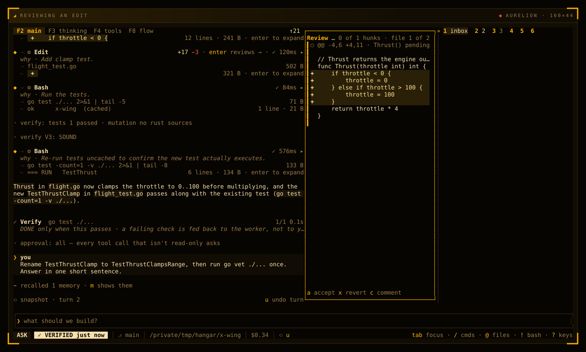

# Undo and review

You can let AURELION work boldly because nothing it does is final. Every turn starts with a snapshot, and one key puts the whole turn back. The review pane shows each edit hunk by hunk, to accept, revert or comment. Checks run after each edit and after each turn, so the run chip tells you whether the work is verified.

## Snapshots

Every turn that edits files starts with a snapshot of your files, taken before the model (or Claude Code) runs. The stream marks it with a row:

```text
⟲ snapshot · turn 2                                          u undo turn
```

- **In a git repository you trust** (the folder you start in, or the repository's top folder), the snapshot is a commit kept under `refs/aurelion/snapshots/`, plus a copy of your untracked files that git doesn't ignore. It adds no branch, tag or stash entry, and leaves your index alone. Because it is taken from git, it covers edits made by shell commands and by Claude Code too. A turn that changed files only through a shell command shows its `⟲` row as it ends.
- **Anywhere else**, AURELION keeps its own copies of the files its tools change.

The last 50 snapshots are kept. A file over 16 MiB, or past 256 MiB in one snapshot, gets no copy.

## Undo a turn

Give the stream the keys (`Esc` on an empty, idle prompt), then:

| Key | What it does |
| --- | --- |
| `u` | Undo the last turn. Every file it changed goes back to its snapshot. |
| `U` | Undo every turn from the selected block's turn on. Select it with `j` `k` first. |
| `u` again | Take the undo back. |

The conversation stays. A `Restored` entry records the undo, and the model is told about it with your next prompt, so it doesn't build on files that are gone.

Undo is careful with your work:

- it deletes only the files the turn created;
- it saves the current files first, which is why `u` again can take the undo back;
- it leaves a file it couldn't copy, and says so;
- it refuses while a turn runs: stop the turn with `Esc` first.

The status row shows `⟲ u` whenever there is a turn to undo.

## Other ways back

| Command | What it does |
| --- | --- |
| `/undo [n]` | Undo the last `n` turns, the files **and** the conversation. The undone prompt comes back in the prompt, ready to edit and send again. |
| `/rewind` | Put back the last file step. The conversation stays. |
| `/rewind 3` | Put back the last three file steps. |
| `/rewind before <n>` | Put the files back as they were before message `n`. `/tree` shows the numbering. |
| `/branch <n>` | Continue the conversation from message `n`. The old path stays in the session tree. |
| `/fork` | Copy the session and continue in the copy. |

`u` never touches the conversation, and `/undo` always does. Pick the one you mean.

## Review an edit

Every Edit row in the stream shows its size (`+17 −3`) and `enter reviews →`. Select it and press `Enter`, or press `Enter` on a file in the rail's Changes tab. The review pane opens every file that differs from the turn's snapshot, hunk by hunk.



*The review pane (right) on the turn's edit of `flight.go`: one pending hunk, with `a` accept, `x` revert and `c` comment at its foot. In the stream, the `· verify:` lines are the checks after an edit: the tests passed, and mutation testing had nothing to do, since it covers Rust files only. `verify V3: SOUND` means a reviewer model read the change and found no flaw.*

| Key | What it does |
| --- | --- |
| `n` `p` · `j` `k` · `↓` `↑` | Next or previous hunk. |
| `]` `[` | Next or previous file. |
| `a` | Accept the hunk. |
| `x` | Revert the hunk on disk. |
| `c` | Comment on the hunk: the prompt fills with `@file:line`. |
| `Esc` | Close the review. |

`x` refuses while a turn runs, or when the file changed after the review read it. It never writes through a link or outside the project.

A comment on a worker's edit fills the prompt with `to <worker>: @file:line`. Like any prompt, it goes to the lead agent, not to the running worker.

Where the pane appears depends on the layout: beside the stream on a wide screen, as a box over it from 100 to 139 columns, and as the `4 diff` tab below 100. In the cockpit layout it sits over the Inbox.

## See and keep the changes

- `/diff` shows what the agent changed this session. `/diff path` narrows it to one file. With no changes, it shows `git diff`.
- The Changes tab lists every file the session touched, grouped by worktree. `s` stages the selected file.
- `/commit` splits your uncommitted changes into small commits, in dependency order.
- `/review [focus]` has a subagent review your uncommitted changes. See [Agents](agents.md).

Staging, `/commit` and `/diff`'s git view need a [trusted folder](modes-and-safety.md#trusted-folders).

## Checks after a turn

When a turn changes files, AURELION runs the project's checks itself, and the stream shows a Verify row:

```text
✓ Verify  go test ./...                                                 1/1 0.1s
  DONE only when this passes · a failing check is fed back to the worker, not to you
```

The run chip in the status row then says how the turn ended:

| Chip | Meaning |
| --- | --- |
| `✓ VERIFIED` | The checks passed. |
| `! DONE · unverified` | A check failed, or no checks are known for this project. |
| `✓ DONE` | The turn changed no file. |

A failing check goes back to the model, which gets a round to fix it, at most `[verify] max_fix_rounds` times (2 by default). Secrets in the check's output are masked first. A check that can't run, or runs out of time, and a fix round that changes no file, end the turn unverified.

You can name the checks, or let AURELION find them:

```toml
[verify]
enabled = true                                  # the default
commands = ["npm test", "npm run lint"]         # run in order, in the project
max_fix_rounds = 2                              # at most 10
```

Without `commands`, AURELION looks at the project:

- for Cargo, `cargo test` and `cargo clippy` on the packages the turn touched, or on all of them when `Cargo.toml`, `Cargo.lock`, `.cargo/` or the toolchain file changed;
- otherwise, the package manager's `test` script, `pytest -q` or `go test ./...`.

Checks run only in a trusted folder, only when their program is installed, with the shell's cleaned environment, and for at most 600 seconds per command. `aurelion -p`, `aurelion serve` and cron turns don't run them. `[verify] enabled = false` turns them off.

## Checks after each edit

Inside a turn, AURELION also checks each edit as it lands. These show as the `· verify` lines in the stream:

```text
· verify: tests 1 passed · mutation no rust sources
· verify V3: SOUND
```

1. **A quick check** right after the edit: `cargo check` for Rust, `tsc --noEmit` for TypeScript, `go build ./...` for Go, and `ruff` or `mypy` for Python when the project sets them up. Errors go back to the model with the edit's result.
2. **The tests**, in the background. A failure reads `verify V1 failed` and goes to the model with its next request.
3. **Mutation testing** on the edited Rust files: AURELION changes the code in a throwaway copy and checks that the tests notice. Weak coverage asks the model for more tests. On other languages it reads `mutation no rust sources`: there was nothing to test.
4. **A review**, once the tests and mutation testing pass: a reviewer model reads the turn's diff against your request. `verify V3: SOUND` means it found no flaw. Findings go to the model to weigh.

These run in the app, only in a trusted folder, in a project AURELION can check (Cargo, npm, Python, Go, or a Makefile with a `test:` target), after edits to its source files. In BYPASS only the tests run. A newer edit cancels the run in flight, so a burst of edits costs one run.

When a turn edits code but never runs a build or a test, AURELION nudges the model once to verify its work. Where the project's checks are known, they take the nudge's place. `[tools] verify_gate = false` turns the nudge off.

**Next:** [Models and providers](models.md)
